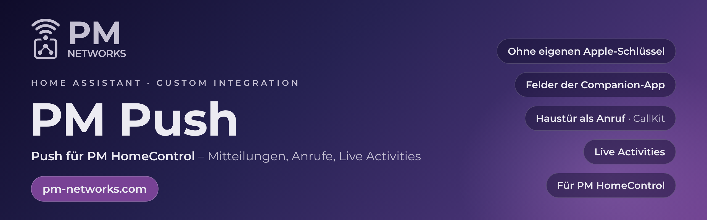

<p align="center">
  <a href="https://pm-networks.com"></a>
</p>

<p align="center">
  <a href="https://pm-networks.com"></a>
  <a href="https://hacs.xyz"></a>
  <a href="https://github.com/PMNetworks/pm-push/releases"></a>
  
</p>

# PM Push

Integration für Home Assistant, die **PM HomeControl** auf dem iPhone mit Push versorgt: Mitteilungen, Anrufe über
CallKit und Live Activities. Sie versteht dieselben Felder wie die Companion-App, damit bestehende Automationen mit wenig
Aufwand umziehen. Einrichten heißt: hinzufügen, fertig. Ein Konto bei Apple oder einen eigenen Schlüssel brauchen Sie
nicht; zugestellt wird über den Dienst PM Push von PM Networks.

> **PM Networks:** weitere Integrationen und Apps für Home Assistant auf [pm-networks.com](https://pm-networks.com).

## Was PM Push kann

| | |
|---|---|
| **Mitteilungen** | `notify.pm_push` (alle iPhones) und `notify.pm_push_<gerät>` mit den Feldern der Companion-App: `push.interruption-level`, `tag`, `group`, `subtitle`, `url`, `actions`, `image`, `entity_id` (Kamerabild), `clear_notification`. |
| **Kritische Hinweise** | `interruption-level: critical` kommt als kritische Mitteilung mit kritischem Ton: Sie klingelt auch bei Lautlos und im Fokus. Das setzt die Berechtigung von Apple für PM HomeControl voraus; ohne sie kommt die Mitteilung zeitkritisch. Ein Anruf folgt nicht. |
| **Haustür als Anruf** | `pm_push.anruf` ruft über CallKit an, standardmäßig nur auf iPhones, deren Person unterwegs ist. Nimmt ein iPhone an, hören die anderen auf zu klingeln. Anrufe gibt es nur für die Haustür; `anlass: alarm` oder `gefahr` aus älteren Automationen wird als kritische Mitteilung gesendet. |
| **Live Activities** | `pm_push.live_activity` und `pm_push.live_activity_beenden` mit den Feldern eines typischen `script.live_activity`: Titel, Meldung, Phase, Fortschritt, Farbe, Restzeit, „nur wenn zu Hause“. Sperrbildschirm und Dynamic Island. |
| **Knöpfe in Mitteilungen** | lösen `mobile_app_notification_action` aus wie bei der Companion-App, auch für Benutzer ohne Adminrecht. |
| **Auch ohne Internet** | Die geöffnete App zeigt die Live Activities der Automationen direkt über die Verbindung zu Home Assistant; Push sorgt dafür, dass sie auch bei geschlossener App ankommen. |

## Installation

[](https://my.home-assistant.io/redirect/hacs_repository/?owner=PMNetworks&repository=pm-push&category=integration)

1. HACS → ⋮ → *Benutzerdefinierte Repositories* → `https://github.com/PMNetworks/pm-push`, Typ *Integration*.
2. *PM Push* herunterladen und Home Assistant neu starten. Updates bietet HACS danach selbst an.

## Einrichtung

[](https://my.home-assistant.io/redirect/config_flow_start/?domain=pm_push)

1. *Einstellungen → Geräte und Dienste → Integration hinzufügen → PM Push* und bestätigen. Einzutragen ist nichts.
2. PM HomeControl auf dem iPhone öffnen und anmelden. Jedes iPhone meldet sich selbst an; es entsteht
   `notify.pm_push_<name>`.
3. Optional unter *Konfigurieren → Allgemein*: Zonen, die als zu Hause gelten (dort ruft die Haustür nicht an).

## So kommt der Push aufs iPhone

```
Automation ─▶ PM Push (Home Assistant) ─▶ PM Push Relay (PM Networks) ─▶ Apple (APNs) ─▶ iPhone
```

Pushes an eine App kann Apple nur mit dem Schlüssel des Herausgebers der App annehmen. Diesen Schlüssel hält allein das
Relay von PM Networks. Bei der ersten Anmeldung weist PM HomeControl über DeviceCheck von Apple nach, dass sie die echte
App auf einem echten iPhone ist, und erhält zu jedem Push-Token eine Kennung. Nur mit Token und passender Kennung nimmt
das Relay einen Push an; beides kennt nur Ihr Home Assistant.

## Beispiele

Klingeln als Anruf (die Klingel-Entität ist ein Platzhalter):

```yaml
triggers:
  - trigger: state
    entity_id: binary_sensor.KLINGEL
    to: "on"
actions:
  - action: pm_push.anruf
    data:
      anlass: haustuer
```

Alarm, Rauch oder Gas als kritische Mitteilung (die Entität ist ein Platzhalter):

```yaml
triggers:
  - trigger: state
    entity_id: binary_sensor.RAUCHMELDER
    to: "on"
actions:
  - action: notify.pm_push
    data:
      title: Rauchmelder
      message: Im Flur wurde Rauch erkannt.
      data:
        push:
          interruption-level: critical
          sound:
            name: default
            critical: 1
            volume: 1.0
```

Mitteilung mit Knopf und Kamerabild:

```yaml
action: notify.pm_push
data:
  title: Haustür
  message: Paket abgestellt.
  data:
    tag: paket
    entity_id: camera.HAUSTUER
    push:
      interruption-level: time-sensitive
    actions:
      - action: PAKET_GESEHEN
        title: Gesehen
```

Live Activity aus einem bestehenden Skript heraus, als zusätzlicher Schritt neben den Companion-Aufrufen:

```yaml
- action: pm_push.live_activity
  continue_on_error: true
  data:
    tag: "{{ tag }}"
    titel: "{{ titel }}"
    meldung: "{{ meldung }}"
    stufe: "{{ stufe | default('', true) }}"
    fortschritt: "{{ fortschritt | default(0) }}"
    fortschritt_max: "{{ fortschritt_max | default(100) }}"
    icon: "{{ icon | default('mdi:home-assistant', true) }}"
    farbe: "{{ farbe | default('#2196F3', true) }}"
    restzeit: "{{ restzeit | default(0) }}"
    ton: "{{ ton | default(false) }}"
    nur_zuhause: "{{ nur_zuhause | default(false) }}"
```

Und zum Schließen:

```yaml
- action: pm_push.live_activity_beenden
  continue_on_error: true
  data:
    tag: "{{ tag }}"
```

## Ereignisse

| Ereignis | Wann |
|---|---|
| `pm_push_anruf` | Ein Anruf ging an die iPhones (Anlass, Kennung, erreichte Geräte). Bei `alarm` oder `gefahr` mit `mitteilung: true`: gesendet wurde eine kritische Mitteilung. |
| `pm_push_anruf_angenommen` | Ein iPhone hat angenommen; etwa um den Türdienst zu übergeben. |
| `pm_push_geraet_registriert` | Ein iPhone hat sich zum ersten Mal angemeldet. |
| `mobile_app_notification_action` | Knopf in einer Mitteilung, wie bei der Companion-App. |

## Sicherheit und Datenschutz

- Das Relay speichert weder Inhalte noch Token und protokolliert keine Nachrichten; es reicht jeden Push direkt an Apple
  weiter. Je Gerät gelten Obergrenzen (je Minute und Tag), damit sich niemand mit fremden Token Pushes erschleichen kann.
- Ein iPhone gehört dem Konto in Home Assistant, das es angemeldet hat; ein anderes Konto kann es nicht übernehmen.
  Token und Kennungen werden nur in fester Form angenommen, ungültige vergessen.
- Bilder für Mitteilungen lädt die App mit ihrem Zugriffstoken nur vom eigenen Home Assistant, nie von fremden Adressen.
- Live Activities der geöffneten App laufen ohne das Relay, direkt über die Verbindung zu Home Assistant.

## Lizenz

© 2026 PM Networks. Alle Rechte vorbehalten; proprietäre Software, siehe [`LICENSE`](LICENSE) und
[`AGENTS.md`](AGENTS.md). Die Installation über HACS zur eigenen, privaten Nutzung ist erlaubt; weitere Rechte werden
nicht eingeräumt.
